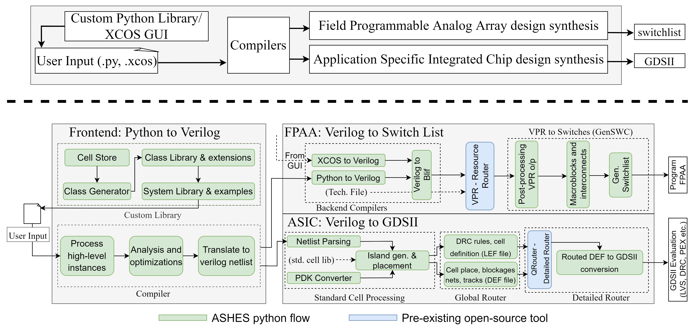

# Analog Synthesis for High Level Systems (ASHES)

ASHES is an (in-progress) tool that is capable of programming Field Programmable Analog Arrays (FPAAs) or generating tapout files (.gds) for analog computing applications using a programmable analog standard cell library. 

- Check out the initial paper on the tool. [Journal](https://www.mdpi.com/2079-9268/13/4/58)
- Learn more about FPAAs. [IEEE Link](https://ieeexplore.ieee.org/document/8915721), [PDF](https://hasler.ece.gatech.edu/FPAA_IEEEXPlore_2020.pdf)
- Learn more about the programmable analog standard cell flow across process nodes. [65nm](https://ieeexplore.ieee.org/document/10639182), [130nm](https://ieeexplore.ieee.org/document/10431551) 



## Project Requirements
- **Operating system:** The project has been tested in a linux environment on an Ubuntu 22 distro.  
- **Programming Tools:** Python3, TK/TCL, Scilab/XCOS and Bash.

### Dependencies

The tool can be installed as a standalone package whose outputs stop before the detailed router (Qrouter) for the ASIC flow and before the resource allocator (VTR/VPR) for the FPAA flow. To install dependencies for just the python package run the following line.

```
pip install numpy verilog-parser
```

However, to use the full capabilities of the tool please follow the instructions below.

### Installation
To install the tool as a local package, follow the following steps
```
git clone https://github.com/GTIceLab/ashes
cd ashes

python3 -m venv venv
source venv/bin/activate

pip install -e .
```
To run,
```
ashes asic /path/to/design.py
```
or 
```
ashes fpaa /path/to/design.py
```
Depending on if you want to target an FPAA or synthesize an ASIC

To add std cell def (json or py) from GDS, run,
```
gen_stdcell_defs <gds_path_input> -json <json_lib_path_output> -pydef <py_defs_path_output> -pn XXX -foundry XXXX

Flags:
-pydef specifies output pydefinition file
-json specifies output json file

(process node and foundry defaults to TSMC 350nm if not overridden)
-pn or --process_node 
-foundry or--foundry 

Notes:
-gds input path input must go first
-foundry is case sensitive
-providing an argument for process node will default to appending ‘nm’ to the end. <130> or <130nm> are acceptable


```

### ASIC Flow: OpenROAD

#### Linux environment required

Run all commands in **Linux**, **WSL2 with Ubuntu**, or a **Linux VM**. On
Windows, open your Ubuntu/WSL terminal first. A GUI requires a working Linux
display, such as WSLg; batch routing does not. Install ASHES, OpenROAD, and
KLayout in the same Linux environment.

#### Install ASHES and OpenROAD

This workflow is available on `ashes_2p0`. Use Python 3.12 or newer:

```bash
cd /path/to/ashes
git switch ashes_2p0
python3 -m venv venv
source venv/bin/activate
python -m pip install -e .
```

Follow the [official OpenROAD installation guide](https://openroad.readthedocs.io/en/latest/user/Build.html)
for supported systems and installation methods. Its source-build procedure with
GUI support is:

```bash
git clone --recursive https://github.com/The-OpenROAD-Project/OpenROAD.git
cd OpenROAD
sudo ./etc/DependencyInstaller.sh
bazelisk run --//:platform=gui //:install
export PATH="$(realpath ../install/OpenROAD/bin):$PATH"
openroad -version
openroad -help
```

For new terminals, add the corresponding absolute `bin` path to your shell's
PATH configuration. Keep the installed runtime files alongside the executable.
See the upstream guide for prebuilt packages and CLI-only builds.

For optional routed GDS export, install KLayout. On Ubuntu:

```bash
sudo apt update
sudo apt install klayout
klayout -v
```

ASHES generates its own OpenROAD Tcl; OpenROAD-flow-scripts is not required.
RASP30/Scilab are needed for the FPAA workflow, not this ASIC workflow.

#### Configure the design

The design Python file must define `Top`, `design_limits`, and
`location_islands`. This branch uses:

```python
import ashes_fg.asic.asic_compile as ac
```

Use Python cell definitions generated from the same GDS files used for physical
synthesis. Existing direction suffixes must not be added a second time.

Put `synthesis_settings.json` and `pd_settings.json` beside the design. For a
Sky130 project arranged as `project/lib/` and
`project/run_syn/Sky130_Trial/`, an example synthesis configuration is:

```json
{
  "process": "sky_130nm",
  "lib_path": "../../lib",
  "pd_tool": "openroad"
}
```

Run ASHES from the design directory: relative `lib_path` values are resolved
from the shell working directory. This branch's compile API does not accept the
`process_coordinates` setting introduced on newer branches.

The physical-design settings use these sections (distances are in microns):

| Section | Configuration |
| --- | --- |
| `init` | Technology LEF (`tlef_path`), optional Liberty files, power/ground net names, and NDR definitions. |
| `pins` | Existing LEF CORE `site`, `place_type: "side"`, and N/S/E/W layer, size, and offset settings. |
| `power` | Global power connections and optional ring/stripe geometry. |
| `route` | `bot_layer`, `top_layer`, and `iterations`. |
| `signoff` | Optional `def2stream` configuration for KLayout GDS export. |

For Sky130, use the exact metal names from your LEF, such as `METAL2` through
`METAL5`, and a CORE site such as `unithd` only if that site exists in the LEF.
Define the `ANALOG` NDR, which the generator assigns to default circuit nets,
and every other rule explicitly used by your circuit. Route settings can be:

```json
"route": [
  {"bot_layer": "METAL2", "top_layer": "METAL5", "iterations": 10}
]
```

The power generator creates a PDN only when ring/stripe shapes are configured.
Global connection declarations alone do not create rings. Its PDN shape support
currently requires one power/ground pair; design multi-supply distribution
explicitly. Adapt all settings to the actual circuit and technology.

#### Generate and run with multiple CPU threads

Activate the ASHES environment, then run from the design directory:

```bash
cd /path/to/project/run_syn/Sky130_Trial
ashes asic Trail.py
openroad -threads 8 -exit -log openroad.log openroad/Trail/main.tcl
```

ASHES prepares the netlist, placement, and Tcl files. OpenROAD is invoked
separately. The generated folder uses the design filename stem (`Trail`).
`main.tcl` enters its own `run/` directory and executes `init.tcl`, `pins.tcl`,
`power.tcl`, `route.tcl`, and `signoff.tcl` in that order.

Use all available threads or run with the GUI:

```bash
openroad -threads max -exit openroad/Trail/main.tcl
openroad -gui -threads 8 openroad/Trail/main.tcl
```

Only multithreaded stages use all selected CPUs. Outputs are saved under
`openroad/Trail/outputs/`: `Trail.odb`, `Trail.def`, `Trail.v`, `Trail.lef`,
`route.guide`, and `route_drc.rpt`. Review routing/DRC reports before treating
the result as complete. To inspect the saved database without rerunning routing:

```bash
openroad -gui -db openroad/Trail/outputs/Trail.odb
```

#### Optional routed DEF-to-GDS export

Add this `signoff` section to `pd_settings.json`, using paths for your project:

```json
"signoff": [
  {"def2stream": {
    "tech_lef": "../../../../../lib/tech_lef/sky130.lef",
    "layer_map": "../../../../../lib/layer_map/sky130_EDA.layermap",
    "in_files": "../../lib/gds",
    "def_units": 1000
  }}
]
```

Regenerate with `ashes asic Trail.py`, then rerun OpenROAD. KLayout merges the
routed DEF and source cell layouts into `Trail.gds`. Without `def2stream`, GDS
export is skipped while the other signoff outputs are written.

Relative technology LEF and layer-map paths are evaluated from
`openroad/Trail/run/`. The current generator resolves `in_files` from the
directory where `ashes` is invoked. The example paths follow the layout above;
absolute paths can also be used.

Use a KLayout LEF/DEF `.layermap`, not the ASHES `sky130.json` library map.
Layer names must match the technology LEF. Verify GDS layer/datatype numbers
against the [SkyWater layer reference](https://skywater-pdk.readthedocs.io/en/main/rules/layers.html).

#### Troubleshooting

- **Unexpected keyword `pd_tool`:** check the active branch/environment and run
  `python -m pip install -e .` from the OpenROAD-capable checkout.
- **Missing NDR target or cell port:** inspect earlier Verilog/LEF warnings;
  check pin names, widths, and endpoints. `VINJ_n` and `VINJ_n_n` are different.
- **CORE site error:** select an existing CORE site with `pins.site`.
- **Missing layer mapping:** check exact LEF names and mapping purposes. Ignored
  routing shapes can leave the exported GDS incomplete.
- **Generated library syntax error:** run `python -m py_compile cells.py` and
  resolve invalid source label/interface names before synthesis.

### ASIC Flow: Detailed Router
For the detailed router we use the same tool from the [open circuit design flow by Tim Edwards](http://opencircuitdesign.com/qrouter/). The following instructions are copied verbatim from the [qrouter repository](https://github.com/RTimothyEdwards/qrouter). The tool has been tested using version 1.4.

Download qrouter [here](https://github.com/RTimothyEdwards/qrouter)

Double check you have all the dependencies installed
```
sudo apt-get install tcl8.5-dev
sudo apt install tk-dev
sudo apt-get install libxt-dev
```
*After downloading the Qrouter repository, `cd` into the folder* then run the following commands
```
./configure
make
make install
```

### FPAA Flow: RASP30 Tool
The RASP30 tools are an earlier GUI based tool that evolved solely to program the 3.0 generation of FPAAs. Check out the [journal](https://link.springer.com/article/10.1007/s10617-021-09247-9) to learn more. As a result, ASHES incorporates a lot of that structure for its purely text-based flow. The repository comes with VPR but requires the installation of Scilab. 

- Download the rasp30 repository [here](https://github.com/jhasler/rasp30/tree/master)
- Download and install Scilab 5.5.2 [here](https://www.scilab.org/download/previous-versions)

Or reach out to the [lab PI](https://hasler.ece.gatech.edu/) for a copy of a VM with rasp30 and scilab pre-installed. 


## Usage

1. Use examples to program a circuit to the FPAA.

```python
import ashes_fg as af
from ashes_fg.examples import ors_buffer

af.fpaa.compile(ors_buffer, project_name='ors_buffer', chip_num=13)
```

Or define your own circuits using the class library.

```python
def ors_buffer():
    inpad1 = fg.inpad([5])
    buff_out = fg.ota_buf(inpad1)
    outpad = fg.outpada(buff_out, [6])
```

2. Use examples to generate an ASIC layout.

```python
import ashes_fg as af
from ashes_fg.examples import the_small_asic_v2

af.asic.compile(the_small_asic_v2, project_name='asic_alice')
```

Or similarly create custom designs from the standard cell library

```python
def small_classifier(vector_in):
    vmm = fg.vector_matrix_multiply(vector_in, dims=(1,6))
    wta = fg.wta_direct_vmm(vmm, vmm, vmm, vmm, num_instances=1)
    scan = fg.scanner(wta, wta, wta, wta, num_instances=1)
    return vmm, wta, scan

def the_small_asic_v2():
    afe = fg.fixed_size_afe(None)
    vector_in = [afe]
    vmm, wta, scan = small_classifier(vector_in)
    return vmm, afe, wta, scan
```

## Outputs
- FPAA Programming
    - Without the rasp30 repo, the tool can produce up to the `.blif` netlist. 
    - With the repo and an FPAA board, the tool can generate the final switchlist which it would subsequently program the connections on the device.
- ASIC Synthesis 
    - Without the detailed router, the tool can generate placement and write out that gds to `<project_name>_placed.gds`.
    - With the detailed router installed, it will create the final routed version `<project_name>_merged.gds`.
- To view `.gds` output, download [klayout](https://www.klayout.de/) or import into a viewer of your choice.

## Building documentation site (For developers only)
The following instructions details how to setup and build a local site for the ASHES documentation. This documentation site is built with Mkdocs with the Material theme.

1. Navigate to the directory `ashes/`
2. Execute `python -m venv .env` to create a Python virtual environment.
3. Execute `source .env/bin/activate` to activate the environment.
4. Execute `python -m pip install -r requirements.txt` to install necessary dependencies for mkdocs.
5. Execute `mkdocs build` to build the documentation site after any updates to the docstrings or markdown files under `docs/`.
6. Now, you have two options
    - Execute `mkdocs serve` to setup a locally hosted site on you local machine.
    - Execute `mkdocs gh-deploy` to upload your changes to the deployed documentation page [here](https://gticelab.github.io/ashes/)